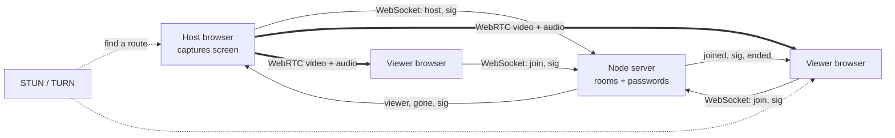

<p align="center">
  <a>
    
  </a>
</p>
<p align="center">
 share your screen to any browser with a room code and a password 📡
</p>


<p align="center">
  <a href="#run-it"></a>
  <a href="#architecture"></a>
  <a href="#architecture"></a>
  <a href="#put-it-online"></a>
  <a href="#hardware-and-network-notes"></a>
</p>


> **⚠️ Honest framing.** Screen Cast is a small, self-hosted screen-sharing site, not a managed meeting platform. There are no accounts, no recordings and no chat. Rooms live in server memory and disappear when the host stops or the server restarts. Video goes directly from the host's browser to each viewer, so the host's upload speed limits how many people can watch. The 60 and 100 fps modes are requests to the browser: real speed is capped by the host screen's refresh rate (usually 60 Hz), the computer and the network, and on slow connections higher frame rates trade away sharpness. It has not been load-tested.


## Table of contents

1. [Run it](#run-it)
2. [Put it online](#put-it-online)
3. [Using Screen Cast](#using-screen-cast)
4. [Configuration](#configuration)
5. [Services](#services)
6. [Hardware and network notes](#hardware-and-network-notes)
7. [Architecture](#architecture)
8. [Design decisions](#design-decisions)
9. [Project layout](#project-layout)
10. [Testing](#testing)
11. [Local development](#local-development)
12. [Extending](#extending)
13. [Troubleshooting](#troubleshooting)
14. [Known limitations](#known-limitations)
15. [Credits](#credits)


## Run it

You need **Node.js 16 or newer**. There is no database and no build step.

```bash
npm install
npm start
```

Open **http://localhost:3000**.

| Setup | Result |
| --- | --- |
| Host on `localhost` or an `https://` address | Screen capture is allowed |
| Host on plain `http://192.168.x.x` | Browser blocks screen capture (viewers still work) |
| Viewer, any modern browser on any OS | Watches with nothing to install |
| Host on a phone or tablet | Not possible, mobile browsers cannot share their screen |


## Put it online

Free and about five minutes, one time. Any host that runs Node.js with WebSocket support and HTTPS works; these steps use [Render](https://render.com).

1. Create a GitHub repository and upload everything in this folder (`server.js`, `package.json`, `render.yaml`, the `public/` folder). Do not upload `node_modules`.
2. On Render choose **New → Web Service**, pick the repository, and click **Create**. `render.yaml` already holds the settings.
3. When the build finishes you get a link such as `https://screencast-xxxx.onrender.com`. That is your site; HTTPS is automatic, which screen sharing requires.

Free instances sleep when idle, so the first visit after a break can take 30-60 seconds to wake. You can attach your own domain later in Render's settings.


## Using Screen Cast

| Step | Who | What happens |
| --- | --- | --- |
| 1 | Host | Open the site and click **Start a room** in the **Share** row |
| 2 | Host | Set a room code and password (random ones are pre-filled, editable and re-rollable), pick a video quality, optionally switch on **share sound** |
| 3 | Host | Click **Choose a screen and go live** and pick a screen, window or tab in the browser prompt |
| 4 | Host | Share the room code, the password and the link shown on the live page |
| 5 | Viewer | Open the site (or the link), type the room code and password, use the **Watch** row and click **Watch** |
| 6 | Viewer | Watch live; use **Fullscreen**, **Mute/Unmute** and **Leave** from the top bar |

**Things to try**

- Click **Copy link with password**: viewers who open it join instantly, no typing
- Open the link on a projector PC and press **Fullscreen**
- Join from your phone as a second viewer to see the live viewer count change
- Click **Stop sharing** (or use the browser's own "Stop sharing" bar): viewers see "The host stopped sharing"

**Video quality**

| Mode | Frame rate asked for | Bitrate per viewer (min / max) | Best for |
| --- | --- | --- | --- |
| Sharp (default, recommended) | 30 fps | 1.5 / 8 Mbps | Slides, documents, code: keeps text crisp |
| Smooth | up to 60 fps | 2.5 / 12 Mbps | Video and animation on a fast connection |
| Maximum | up to 100 fps | 3 / 15 Mbps | 120/144 Hz screens only; heaviest on the host's internet |

Capture is limited to 2560x1440 so text stays sharp without overloading the host.


## Configuration

Server settings are environment variables. All are optional.

| Variable | Default | Why |
| --- | --- | --- |
| `PORT` | `3000` | Port the site and signaling listen on (Render sets this itself) |
| `MAX_VIEWERS` | `20` | Viewers per room; each one costs the host a separate upload stream |
| `MAX_ROOMS` | `200` | Rooms alive at once on this server |
| `ICE_SERVERS` | Google public STUN | JSON list of STUN/TURN servers, needed on strict networks |

`ICE_SERVERS` example (adds a relay):

```bash
ICE_SERVERS='[{"urls":"stun:stun.l.google.com:19302"},{"urls":"turn:HOST:3478","username":"user","credential":"pass"}]'
```

Host options on the setup screen:

| Option | Rules |
| --- | --- |
| Room code | 3-32 characters: lowercase letters, numbers, dashes. Must be unused |
| Password | Up to 64 characters. Leave empty for an open room |
| Video quality | Sharp, Smooth or Maximum (see above) |
| Share sound | Offered only if the browser and the chosen source support audio |

Invalid room codes and codes already in use are rejected before sharing starts.


## Services

| Path | Purpose |
| --- | --- |
| `/` | The website (host and viewer screens in one page) |
| `/health` | Plain `ok` response for hosting health checks |
| `ws(s)://<same host>/` | WebSocket signaling used by the page |

Everything runs from one process on one port.


## Hardware and network notes

- **Host:** a desktop or laptop with Chrome, Edge, Firefox or Safari. Screen capture is not available on phones and tablets.
- **Frame rate:** most screens refresh at 60 Hz, so expect about 60 fps at best. Only 120/144 Hz screens can go higher, and most viewers' screens are 60 Hz anyway.
- **Sharpness:** each viewer is sent its own stream of up to 8 Mbps (Sharp) to 15 Mbps (Max). If the host's upload is slower than that times the number of viewers, the picture softens.
- **Upload speed:** the host sends one stream per viewer. As a rough guide, 5-10 viewers is comfortable on normal Wi-Fi in Sharp mode; for more, use a faster connection, or fewer viewers on slow connections.
- **Strict networks:** some school and office networks block direct peer-to-peer video. Viewers get stuck on "Connecting" or see "Could not connect directly". Add a TURN relay through `ICE_SERVERS`.
- **Viewers:** any modern browser, including phones and the browser on a projector PC.


## Architecture



```
Host clicks "Start a room"
        ↓
Browser asks which screen to share (getDisplayMedia)
        ↓
Host opens a WebSocket and registers the room (code + password hash)
        ↓
Viewer opens the site, enters code + password
        ↓
Server checks the password, assigns the viewer an id, tells the host "viewer 3 joined"
        ↓
Host creates one WebRTC connection per viewer and sends an offer through the server
        ↓
Viewer answers; both sides swap network candidates through the server
        ↓
Video and audio flow directly host → viewer; the server is no longer involved
        ↓
Host stops (or closes the tab): server tells every viewer "ended" and deletes the room
```

**Signaling messages**

| Direction | Message | Meaning |
| --- | --- | --- |
| client → server | `host` `{room, pass}` | Create a room |
| client → server | `join` `{room, pass}` | Join a room as a viewer |
| client → server | `sig` `{to?, data}` | Relay an offer, answer or network candidate |
| server → host | `hosting`, `viewer`, `gone`, `sig` | Room ready, viewer joined, viewer left, relayed signal |
| server → viewer | `joined`, `sig`, `ended` | Admitted, relayed signal, host stopped |
| server → client | `error` `{code, msg}` | `bad-request`, `busy`, `no-room`, `need-pass`, `bad-pass`, `full`, `blocked` |


## Design decisions

- **The server never touches video.** It only introduces browsers to each other, so it can run on a tiny free instance and your screen content never passes through it.
- **No accounts, no storage.** Rooms exist only in memory. Nothing is written to disk, nothing is logged about content.
- **Passwords are checked, not stored.** The server keeps a SHA-256 hash in memory and compares with `crypto.timingSafeEqual`. Over HTTPS the password travels inside a `wss://` connection.
- **Guessing is throttled.** After 10 wrong passwords or unknown room codes from one IP within 5 minutes, that IP is blocked for the rest of the window (`blocked`).
- **Password in the link stays out of the server.** "Copy link with password" puts it after a `#`, which browsers never send to the server. It is removed from the address bar right after auto-join. The server also sends `Referrer-Policy: no-referrer`.
- **Mesh, not a media server.** The host connects to every viewer directly. That is simple and free, but upload cost grows with the number of viewers; the cap is `MAX_VIEWERS`.
- **Sharp by default.** Sharp mode sets the video `contentHint` to `detail` so the browser keeps resolution instead of dropping it; Smooth and Max use `motion` (keep frame rate). All modes also ask the sending browser for a higher minimum and starting bitrate (through `x-google-*` codec parameters on the viewer's answer) so the picture does not begin blurry while the network estimate warms up.
- **Dead connections are cleaned up.** The server pings every 25 seconds and drops sockets that stop answering; this also keeps hosting platforms from closing idle connections.
- **A TV test pattern as the identity.** The color bars (the signal you see when a channel is waiting) run along the top of every page, appear in the logo, and fill the viewer's screen while it connects; the same pattern turns grey when the host stops. Buttons and room-code characters share one look: ink outline, hard bottom edge, and a press-down effect.
- **One file for the whole interface.** `public/index.html` has the page, styles and logic, so there is no frontend build.


## Project layout

```
screencast/
├── server.js          # Node server: serves the page, rooms, passwords, relays signaling
├── package.json       # Project info; the only dependency is "ws"
├── render.yaml        # Ready-made Render settings
├── README.md          # This file
├── .gitignore         # Keeps node_modules out of GitHub
└── public/
    └── index.html     # Home, host setup, live host page and full-screen viewer
```

| Path | Role |
| --- | --- |
| `server.js` | HTTP for `/` and `/health`, WebSocket signaling, room table, throttling, heartbeat |
| `public/index.html` | The entire interface and the WebRTC code for both host and viewer |
| `render.yaml` | Web service definition: Node, free plan, `npm install`, `npm start`, `/health` check |
| `package.json` | Node 16+ requirement and the `ws` dependency |


## Testing

There is no automated test suite yet. A quick manual check after any change:

1. `npm start`, open `http://localhost:3000` in two browser windows.
2. Window A: **Start a room**, share a window. Window B: join with the code and password; the video should appear within a few seconds.
3. Join with a wrong password: you should see "Wrong password."
4. Join with an unknown code: you should see "Room not found."
5. Stop sharing in window A: window B should show "The host stopped sharing."
6. Join from a second device on the same Wi-Fi using `http://<host-ip>:3000` to check cross-device playback.

The signaling server (room creation, duplicate rooms, password checks, relaying, viewer leave, host end, `/health`) was checked with a scripted WebSocket client. Live video in real browsers should be verified on your own devices after deploying.


## Local development

```bash
npm install
PORT=4000 npm start        # use another port if 3000 is busy
```

- Edit `public/index.html` and refresh the page; the server reads the file at start-up, so restart `npm start` after changes.
- To test across devices on your network, viewers can open `http://<your-ip>:3000`. The **host** still needs `localhost` or HTTPS, so run the host window on the machine that runs the server, or deploy.
- Set `ICE_SERVERS` in your shell to try a TURN relay locally.


## Extending

- **Change the quality modes** — the `MODES` table at the top of the script in `public/index.html` holds frame rate, content hint and min/start/max bitrate (kbps) for each mode; the capture size limit is in the `getDisplayMedia` call.
- **Raise or lower limits** — set `MAX_VIEWERS` and `MAX_ROOMS`.
- **Rebrand** — colors are CSS variables at the top of `public/index.html` (`--yel` for buttons and room-code keys, `--ink`, `--paper`); the test-pattern colors are the `BARS` list in the script; the name is in the `<title>` and the brand blocks.
- **Viewer names** — add a `name` field to the `join` message in `onJoin` (`server.js`), pass it in the `viewer` message to the host, and show it in the host page.
- **Real accounts or per-room owners** — put your check in `onHost` and `onJoin` in `server.js`.
- **A TURN relay for strict networks** — run your own (for example coturn) or use a hosted one, then set `ICE_SERVERS`.
- **New message type** — handle it in the `message` switch in `server.js` and in the matching `onmessage` in `index.html`.


## Troubleshooting

| Problem | Fix |
| --- | --- |
| "This browser or device cannot share its screen" | Use Chrome, Edge, Firefox or Safari on a laptop/desktop, and open the `https://` (or `localhost`) address |
| Screen picker never appears | Allow screen capture for the site in the browser; on macOS enable Screen Recording for the browser in System Settings |
| "Room not found" | Check the code; the host must have started sharing, and the room ends when the host stops |
| "Wrong password" | Passwords are case-sensitive; ask the host to read it from their live page |
| "Too many wrong attempts" | Wait about 5 minutes, then try again |
| "That room code is already in use" | Pick another code on the setup screen |
| Viewer stuck on "Connecting" | Likely a network that blocks peer-to-peer video; add a TURN server via `ICE_SERVERS` |
| First visit is very slow | Free hosting was asleep; wait up to a minute and refresh |
| No sound for viewers | Tick **share sound**, and in the browser prompt choose a tab or source that offers audio; viewers tap **Unmute** |
| Text looks soft or blurry | Use **Sharp** mode, share a window instead of a huge screen, and check the host's upload speed (8 Mbps per viewer in Sharp mode); Smooth and Max favor frame rate over clarity |
| Choppy video | Fewer viewers, **Sharp** mode, or a faster connection for the host |
| Mirror-in-mirror tunnel on the host preview | Share a different window or screen than the one showing the Screen Cast page |
| Port already in use locally | Start with another port: `PORT=4000 npm start` |


## Known limitations

- Rooms are in memory only; a server restart or sleep ends every room.
- Smooth and Max ask for up to 60 and 100 fps but deliver what the screen, computer and network allow (usually about 60).
- Each viewer adds upload load on the host; there is no media server to fan out streams.
- No TURN relay is included, so some strict networks will not connect.
- Screen sharing works only from desktop browsers; phones and tablets can watch, not share.
- Shares the primary capture choice the browser offers; there is no multi-screen layout or per-viewer control.
- No chat, recording, viewer names or host controls to remove a viewer (yet).
- No automated test suite; not load-tested.


## Credits

Built on [WebRTC](https://webrtc.org), [Node.js](https://nodejs.org), [ws](https://github.com/websockets/ws) and [Render](https://render.com) for hosting.
